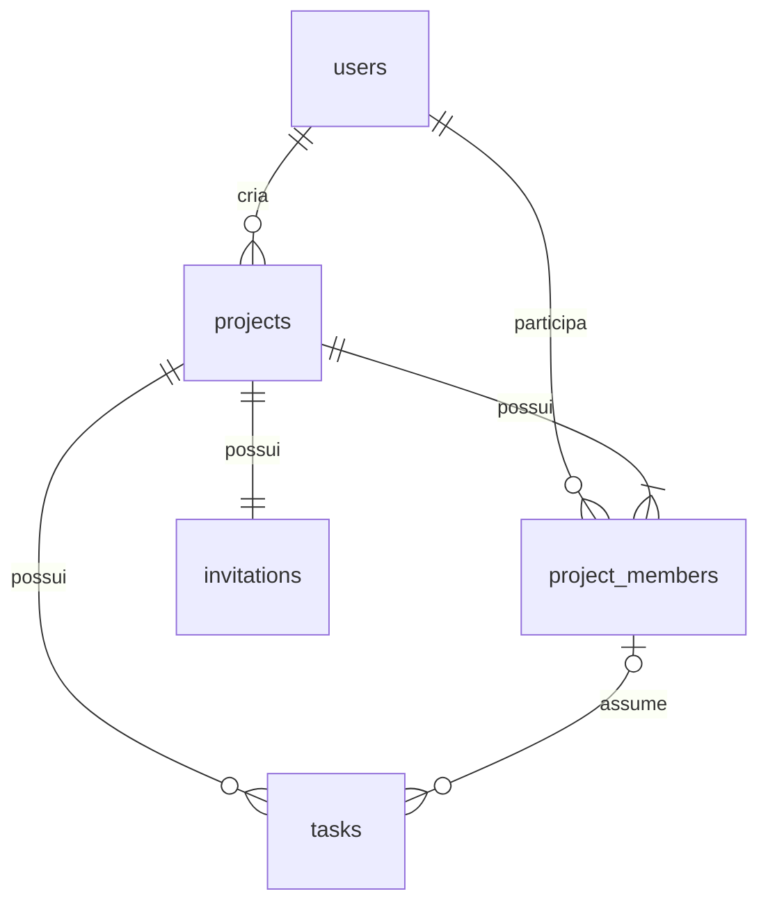

# Deadline

Aplicativo de organização de trabalhos escolares em grupo, com React Native + Expo no navegador e no celular, API Express e persistência MySQL. Interface em português, fundo `#F7F8FA`, vermelho `#EF4444`, cartões, progresso de tarefas, navegação lateral no computador e inferior no celular.

## Estrutura

```text
app/                  Aplicativo Expo (JavaScript)
  screens/            Login/cadastro, dashboard, projetos, tarefas, calendário e perfil
  navigation/         React Navigation, menu responsivo e navegação entre telas
  context/            Sessão JWT e preservação de convite durante o login
  services/           Cliente HTTP, timeout e armazenamento da sessão
  components/         Componentes visuais compartilhados
  theme/              Identidade visual
backend/
  server.js           Inicialização da API na porta 3000
  app.js              Express, CORS, segurança e tratamento de erros
  config/             Pool MySQL na porta 3307
  routes/             Endpoints REST e autorização por projeto/tarefa
  controllers/        Validação dos dados e inclusão de integrantes
  middlewares/        Autenticação JWT
  tests/              Testes HTTP e integração MySQL
database/             SQL de criação e usuário local opcional
tests/web/            Testes de navegação e fluxo completo com Playwright
scripts/              Servidor de teste e execução isolada de MySQL
```

## Requisitos

- Node.js 22.13+ ou versão LTS compatível com Expo SDK 58 (desenvolvido com Node 24).
- MySQL Server 8.0 e MySQL Workbench. O servidor deve escutar em **3307**.
- Expo Go compatível com SDK 58 para celular, ou uma development build.
- Microsoft Edge para os testes automatizados de interface neste Windows.

Use `npm.cmd` e `npx.cmd` no PowerShell: esses executáveis funcionam mesmo quando a política do Windows bloqueia `npm.ps1`. Não é necessário mudar a política de execução.

## 1. Instalar o backend

Abra o PowerShell na pasta deste projeto:

```powershell
cd 'C:\Users\LARISSADAROSAGEWEHR.AzureAD\Documents\deadline2'
cd backend
npm.cmd ci
```

O arquivo `backend/.env` local foi criado com `DB_USER=admin` conforme informado e um segredo JWT aleatório. **Preencha `DB_PASSWORD` com a senha do usuário MySQL**. Não é a senha de uma conta do Deadline. Nunca envie esse arquivo para um repositório.

Se estiver instalando em outro computador, crie primeiro o arquivo:

```powershell
Copy-Item .env.example .env
node -e "console.log(require('node:crypto').randomBytes(48).toString('hex'))"
notepad .env
```

Cole o segredo gerado em `JWT_SECRET` e configure a conexão:

```dotenv
PORT=3000
DB_HOST=127.0.0.1
DB_PORT=3307
DB_USER=admin
DB_PASSWORD="SUA_SENHA_MYSQL"
DB_NAME=deadline
JWT_SECRET=SEU_SEGREDO_ALEATORIO_COM_PELO_MENOS_32_CARACTERES
CORS_ORIGINS=http://localhost:8081,http://127.0.0.1:8081
APP_URL=http://localhost:8081
```

Senhas que contenham `#` devem ficar entre aspas no `.env`.

## 2. Configurar o MySQL

Neste computador foi detectado o serviço `MySQL80` ativo na porta **3307**. Não é necessário mudar a porta dele.

No Workbench:

1. Crie ou edite uma conexão Standard TCP/IP com hostname `127.0.0.1`, porta `3307` e usuário `admin` (ou uma conta administrativa disponível).
2. Conecte usando a senha desse usuário.
3. Abra **File → Open SQL Script**, selecione `database/deadline.sql` e execute o arquivo completo pelo botão do raio.
4. Atualize **Schemas**. O banco `deadline` terá `users`, `projects`, `project_members`, `invitations` e `tasks`.

Alternativa pelo terminal, partindo da raiz do projeto:

```powershell
& 'C:\Program Files\MySQL\MySQL Server 8.0\bin\mysql.exe' --host=127.0.0.1 --port=3307 --user=admin --password --execute='SOURCE database/deadline.sql'
```

O comando pede a senha de forma interativa. O usuário precisa de permissão para criar o banco e as tabelas; depois a aplicação só precisa de `SELECT`, `INSERT`, `UPDATE` e `DELETE`. Opcionalmente execute `database/local-user.sql` como administrador, após trocar a senha no script, e use `deadline_app` no `.env`.

Para uma instalação nova, selecione a porta 3307 no MySQL Installer. Se já houver um servidor em outra porta, ajuste a seção `[mysqld]` de `my.ini` para `port=3307` e reinicie o serviço pelo aplicativo Serviços do Windows. Não altere serviços que atendam a outros projetos sem conferir sua configuração.

O script SQL usa `IF NOT EXISTS`; não apaga os dados e não é executado automaticamente ao iniciar a API. Alterações futuras em tabelas existentes devem ser feitas com migrações explícitas.

## 3. Iniciar a API

No primeiro terminal:

```powershell
cd 'C:\Users\LARISSADAROSAGEWEHR.AzureAD\Documents\deadline2\backend'
npm.cmd start
```

Verifique em outro terminal:

```powershell
Invoke-RestMethod http://localhost:3000/api/health
```

A resposta esperada é `status: ok`, `database: connected`. A API encerra com uma mensagem útil se a senha/conexão ou o segredo JWT estiver incorreto. Ela não cria nem substitui o banco ao iniciar.

## 4. Instalar o Expo e abrir no navegador

No segundo terminal:

```powershell
cd 'C:\Users\LARISSADAROSAGEWEHR.AzureAD\Documents\deadline2\app'
npm.cmd ci
```

O arquivo `app/.env` local já está criado. Em uma cópia nova, execute `Copy-Item .env.example .env`. Para uso no próprio computador:

```dotenv
EXPO_PUBLIC_API_URL=http://localhost:3000/api
```

Então:

```powershell
npm.cmd run web
```

Abra `http://localhost:8081`. Cadastre uma conta de aluno ou professor. Não existem contas pré-cadastradas nem projetos de demonstração. Crie seu primeiro projeto ou entre pelo convite de um colega.

Para gerar a versão web estática:

```powershell
npm.cmd run build:web
```

Os arquivos são gerados em `app/dist`. Para servir um build publicado, configure o servidor de hospedagem para responder com `index.html` às rotas da aplicação e forneça uma API HTTPS acessível. O endereço `EXPO_PUBLIC_API_URL` é incorporado ao build: gere novamente após mudá-lo.

## 5. Abrir no celular e compartilhar com colegas na rede

`localhost` no celular significa o próprio celular. Use o IPv4 do computador da API.

Na raiz, execute:

```powershell
ipconfig
```

Supondo que o IPv4 da placa Wi-Fi seja `192.168.1.50`, altere `app/.env`:

```dotenv
EXPO_PUBLIC_API_URL=http://192.168.1.50:3000/api
```

Em `backend/.env`:

```dotenv
APP_URL=http://192.168.1.50:8081
CORS_ORIGINS=http://localhost:8081,http://127.0.0.1:8081,http://192.168.1.50:8081
```

Reinicie a API e o Expo após alterar os arquivos. No terminal do app:

```powershell
npm.cmd start
```

Escaneie o QR code com Expo Go compatível com SDK 58. Computador e celular devem estar na mesma rede. No terminal Expo pressione `w` se também quiser abrir a versão web; o link web do convite precisa do servidor web ativo. Permita o Node.js no Firewall do Windows para redes privadas, com acesso às portas **3000** e **8081**. Não é necessário expor a porta do MySQL aos celulares.

Para colegas usando navegador, mantenha `npm.cmd run web` ativo e compartilhe o link gerado, por exemplo `http://192.168.1.50:8081/?invite=CODIGO`. O colega entra ou cria conta, confirma a entrada e passa a ver o projeto. O convite não é descartado durante autenticação e a entrada repetida não duplica integrantes.

O esquema nativo `deadline` está declarado em `app.json`. Em uma build instalada, `deadline://join?invite=CODIGO` abre o fluxo do convite. Expo Go usa seu próprio endereço `exp://` fornecido pelo servidor de desenvolvimento; o esquema `deadline://` exige uma build nativa. Veja a [documentação oficial de deep links do Expo](https://docs.expo.dev/linking/into-your-app/). O link HTTP compartilhado pelo app funciona pelo navegador; associação automática de links HTTPS a apps Android/iOS exige domínio e configuração de Universal Links/App Links, que não estão configurados para desenvolvimento local.

## Funcionalidades e permissões

- Cadastro real com e-mail único, senha bcrypt, JWT de 7 dias, seleção de conta `aluno`/`professor`, login e logout.
- Sessão persistida em AsyncStorage no nativo e localStorage na web; token expirado exige novo login.
- Dashboard com contagens reais, entregas em até 7 dias, projetos recentes e progresso ponderado por tarefas.
- Projetos com nome, matéria, tema, descrição, data, status; pesquisa e filtros por matéria/status.
- Criador automaticamente incluído no grupo, convite aleatório de 16 caracteres e link compartilhável.
- Detalhes com integrantes, status, tarefas e progresso automático: tarefas concluídas ÷ total. Sem tarefas, 0%.
- CRUD de tarefas, responsável pertencente ao grupo, prazo, descrição, criação e status.
- Tarefas agregadas em uma tela e calendário mensal com seleção do dia e acesso ao projeto.
- Perfil com dados persistidos, edição de nome/e-mail e contagens de participação/criação.
- Carregamento, estados vazios, mensagens de erro, timeout de requisições e tela de recuperação para erros de renderização.

`aluno` e `professor` são níveis de conta registrados no banco e exibidos no perfil. Ambos podem criar e integrar projetos. Um aluno pode adicionar integrantes nos projetos que criou; um professor também pode adicionar integrantes nos projetos dos quais participa. A API consulta o nível atual no banco em cada requisição protegida. Ser professor não libera acesso a grupos dos quais a pessoa não participa nem permite editar ou excluir projetos de outros criadores.

Em **Nossa equipe → Adicionar integrantes**, o criador ou professor integrante informa o e-mail de uma conta existente. A inclusão é persistida sem duplicação. Para quem ainda não tem conta, o diálogo oferece link e código de convite. O nível é escolhido no cadastro neste projeto acadêmico; não há verificação institucional da condição de professor.

| Ação                                                       | Criador | Integrante |
| ---------------------------------------------------------- | ------- | ---------- |
| Consultar projeto, integrantes, tarefas e progresso        | Sim     | Sim        |
| Editar/excluir projeto                                     | Sim     | Não        |
| Criar/editar/excluir tarefas e definir responsáveis/prazos | Sim     | Não        |
| Alterar status de qualquer tarefa                          | Sim     | Não        |
| Alterar status das próprias tarefas atribuídas             | Sim     | Sim        |
| Compartilhar convite pela interface                        | Sim     | Não        |

Exceção por nível: professores integrantes também podem adicionar integrantes e acessar o compartilhamento no diálogo de inclusão; alunos integrantes não têm essa permissão.

As verificações acontecem na API antes das operações. Não integrantes recebem 404 para recursos do grupo. Integrantes recebem 403 ao tentar administrar. Todas as consultas com entrada do usuário são parametrizadas. Cadastro/login têm limitação de tentativas. `CORS_ORIGINS` permite apenas origens explicitamente configuradas.

## Endpoints REST

Prefixo `/api`. Rotas internas exigem `Authorization: Bearer TOKEN`.

| Método             | Rota                                 | Uso                                      |
| ------------------ | ------------------------------------ | ---------------------------------------- |
| GET                | `/health`                            | Conexão com MySQL (pública)              |
| POST               | `/auth/register`                     | Cadastro (pública)                       |
| POST               | `/auth/login`                        | Login (pública)                          |
| GET / PUT          | `/profile`                           | Consultar/editar perfil                  |
| GET / POST         | `/projects`                          | Listar/criar projetos                    |
| GET / PUT / DELETE | `/projects/:id`                      | Consultar/editar/excluir projeto         |
| POST               | `/invitations/join`                  | Entrar com `{ "code": "..." }`           |
| GET / POST         | `/projects/:id/members`              | Listar / adicionar integrante por `{ "email": "..." }` |
| GET / POST         | `/projects/:id/tasks`                | Listar/criar tarefas                     |
| PUT / DELETE       | `/projects/:id/tasks/:taskId`        | Editar/excluir tarefa                    |
| PATCH              | `/projects/:id/tasks/:taskId/status` | Atualizar somente status                 |
| GET                | `/dashboard`                         | Indicadores e projetos reais             |
| GET                | `/calendar`                          | Entregas e tarefas dos grupos do usuário |

Datas usam `AAAA-MM-DD`. Status de projeto: `pendente`, `em andamento`, `concluído`. Status de tarefa: `pendente`, `em andamento`, `concluída`. Criar/editar tarefa recebe `assignee_id` numérico ou `null`. Falhas retornam JSON `{ "message": "..." }` com código HTTP apropriado. Excluir retorna 204 sem corpo.

## Testes

Na raiz:

```powershell
npm.cmd ci
npm.cmd run test:api
```

Os testes HTTP de autenticação, validação e autorização usam um substituto de banco deliberadamente restrito. Não provam persistência. O teste MySQL fica ignorado nesse comando por padrão.

Para executar a integração no banco configurado em `backend/.env`, depois de importar o SQL:

```powershell
cd backend
$env:RUN_DB_TESTS='1'
node --test tests/mysql.integration.test.js
Remove-Item Env:RUN_DB_TESTS
```

Esse teste cria usuários/projeto temporários, verifica bcrypt, login, convite, entrada idempotente, autorização, CRUD, dashboard, calendário e dados persistidos. Remove os registros criados ao final. Prefira um banco separado de avaliação/testes.

Testes de interface (na raiz, após gerar `app/dist`):

```powershell
npm.cmd --prefix app run build:web
npm.cmd run test:web
```

Eles iniciam um servidor temporário na porta 8099 e abrem o Edge invisivelmente. Os testes de navegação interceptam respostas apenas no ambiente de teste; o aplicativo não contém modo de demonstração. O teste de navegador com API real fica ignorado fora do executor isolado abaixo.

Teste completo com MySQL temporário neste Windows:

```powershell
node scripts/test-mysql-isolated.cjs
```

Requer MySQL instalado em `C:\Program Files\MySQL\MySQL Server 8.0\bin` (ou configure `MYSQL_BIN`) e portas 13307, 3000 e 8099 livres. Cria um diretório exclusivo em `artifacts/`, inicia MySQL somente em `127.0.0.1:13307`, importa o SQL duas vezes, executa integração real, inicia API temporária na porta 3000 e executa os testes do navegador, incluindo cadastro → criação de projeto → tarefa → conclusão → recarregamento → exclusão. Encerra os processos temporários ao final. Não altera o serviço MySQL80 nem os arquivos `.env` locais.

Compatibilidade e bundles:

```powershell
cd app
npx.cmd expo install --check
npm.cmd run build:web
npx.cmd expo export --platform android --output-dir dist-android
```

Um bundle Android compilado não equivale a um APK nem a um teste em aparelho físico.

## Entregas da avaliação

1. **Proposta e interface:** organizar trabalhos em equipe, distribuir responsabilidades e acompanhar prazos. Telas navegáveis com identidade visual consistente e adaptação a navegador/celular.
2. **Persistência e API:** modelo relacional MySQL, Express REST, integração das telas e operações GET/POST persistentes.
3. **Autenticação e controle:** bcrypt, JWT, conta aluno/professor, rotas protegidas, autorização no backend e CRUD de projetos/tarefas/perfil.

Sugestão de apresentação: cadastre uma conta aluno e outra professor em navegadores diferentes; crie um projeto com a primeira, compartilhe o convite, entre com a segunda, atribua uma tarefa, conclua como responsável e observe o progresso nas duas contas. Confirme no Workbench que os registros foram gravados.

## Solução de problemas

- **Access denied / ER_ACCESS_DENIED_ERROR:** confira usuário e senha MySQL em `backend/.env`. A senha da conta Deadline não é a senha do banco.
- **ECONNREFUSED:** confirme MySQL em 3307 e API em 3000; inicie os serviços.
- **Unknown database / tabela inexistente:** execute o SQL completo no Workbench.
- **Sem conexão no celular:** troque localhost pelo IPv4 do computador, confira Wi-Fi/firewall e reinicie Expo com `npx.cmd expo start --clear`.
- **Erro CORS:** inclua a origem exata do navegador em `CORS_ORIGINS`, sem barra final, e reinicie a API.
- **Porta ocupada:** feche o processo correspondente antes de iniciar; não encerre serviços desconhecidos.
- **Dependência ausente:** execute `npm.cmd ci` nas pastas backend e app; valide com `npx.cmd expo install --check`.
- **Expo Go incompatível:** use uma versão com suporte ao SDK 58 ou uma development build compatível.

Consulte `VALIDACAO.md` para os resultados realmente executados neste ambiente e as limitações restantes.

## Requisitos funcionais atualizados

| Código | Requisito |
| --- | --- |
| RF01 | Cadastrar conta aluno ou professor com e-mail único e senha armazenada como hash. |
| RF02 | Fazer login, manter sessão com JWT e realizar logout. |
| RF03 | Criar, listar, consultar, editar e excluir projetos persistidos no MySQL. |
| RF04 | Pesquisar projetos e filtrar por matéria e status. |
| RF05 | Incluir integrantes por e-mail ou permitir entrada por convite. |
| RF06 | Criar, consultar, editar e excluir tarefas do projeto. |
| RF07 | Atribuir tarefas a integrantes e atualizar seu status conforme as permissões. |
| RF08 | Exibir progresso, indicadores do dashboard e entregas no calendário. |
| RF09 | Consultar e editar nome e e-mail do próprio perfil. |
| RF10 | Proteger rotas por autenticação, participação no grupo e permissões de nível/criador. |
| RF11 | Informar erros de validação, conexão e autorização sem simular sucesso. |

## Telas e fluxos

- **Cadastro e login:** entrada → criar conta → escolher aluno/professor → cadastro → sessão autenticada → início. O cadastro já retorna JWT; não exige repetir o login.
- **Projeto:** início ou projetos → novo projeto → preencher dados → salvar → detalhes → editar e salvar ou confirmar exclusão.
- **Integrantes:** detalhes → Nossa equipe → Adicionar integrantes → informar e-mail → adicionar → lista atualizada. Disponível para criador ou professor integrante.
- **Convite:** compartilhar link/código → destinatário abre o app → login/cadastro, se necessário → confirmar entrada → detalhes do grupo.
- **Tarefa:** detalhes → nova tarefa → definir responsável, prazo e status → salvar → editar, alterar status ou confirmar exclusão, conforme autorização.
- **Acompanhamento:** início mostra indicadores; tarefas reúne atividades dos grupos; calendário mostra entregas por dia e permite abrir o projeto.
- **Perfil e saída:** clicar na conta no rodapé lateral ou na aba Perfil → dados da conta, lista dos próprios projetos e botão Sair da conta → login inicial. O perfil também permite editar nome/e-mail. A aba Sair oferece outra entrada para encerrar a sessão. Sair remove o token local.

A navegação principal contém Início, Projetos, Tarefas, Calendário, Perfil e Sair. Formulário e detalhes de projeto ficam em uma pilha de navegação. No computador há menu lateral; em telas menores, navegação inferior.

## Modelo de dados e dicionário

Fonte executável: `database/deadline.sql`. As tabelas usadas pela API são as abaixo; tabelas antigas em português existentes em uma instalação local não são consultadas por esta versão.

| Entidade/tabela | Campos e tipos |
| --- | --- |
| Usuário — `users` | `id` INT UNSIGNED PK; `name` VARCHAR(120); `email` VARCHAR(190) UNIQUE; `password_hash` VARCHAR(255); `account_type` ENUM aluno/professor; `created_at` TIMESTAMP. |
| Projeto — `projects` | `id` INT UNSIGNED PK; `owner_id` INT UNSIGNED FK; `name` VARCHAR(150); `subject` VARCHAR(100); `topic` VARCHAR(200); `description` TEXT; `due_date` DATE; `status` ENUM pendente/em andamento/concluído; `created_at` TIMESTAMP. |
| Participação — `project_members` | `project_id` e `user_id` INT UNSIGNED, FKs e PK composta; `joined_at` TIMESTAMP. |
| Convite — `invitations` | `code` CHAR(16) PK com comparação sensível a maiúsculas; `project_id` INT UNSIGNED FK UNIQUE; `created_at` TIMESTAMP. |
| Tarefa — `tasks` | `id` INT UNSIGNED PK; `project_id` INT UNSIGNED FK; `title` VARCHAR(150); `description` TEXT; `assignee_id` INT UNSIGNED NULL; `due_date` DATE; `status` ENUM pendente/em andamento/concluída; `created_at` TIMESTAMP. |

Um usuário cria vários projetos; cada projeto tem um criador. Usuários e projetos têm relação N:N por `project_members`. Cada projeto possui um convite e várias tarefas. O responsável é opcional e deve pertencer ao projeto, garantido pela validação da API e pela chave estrangeira composta de `tasks` para `project_members`. A exclusão de projeto remove participações, convite e tarefas por cascata. O criador entra automaticamente como integrante na mesma transação da criação do projeto. Datas de entrega possuem índices.



## Arquitetura e autenticação

Fluxo de dados: React Native/Expo → `fetch()` em `app/services/api.js` → Express → consultas parametrizadas pelo pool `mysql2` → MySQL. A resposta JSON atualiza as telas após confirmação da API. Projetos e tarefas não são mantidos apenas no armazenamento local.

O cadastro gera hash bcrypt com custo 12. Login compara a senha com o hash e retorna JWT HS256 com validade de sete dias. O cliente guarda o token em AsyncStorage no nativo ou localStorage na web e o envia como Bearer Token. O middleware valida assinatura e expiração; a API carrega o usuário atual do banco antes das rotas internas. O logout remove o token do cliente; não há lista de revogação no servidor, portanto uma cópia do token continua válida até expirar.

A seleção de aluno/professor é livre no cadastro para demonstração acadêmica. Para uso institucional, a concessão do nível professor precisaria de aprovação/verificação. O sistema atual não deve ser apresentado como tendo essa verificação.

## Versionamento e comprovação das entregas

Antes da entrega, execute os testes, revise os arquivos e faça commit e push no repositório da disciplina. Os `.env`, dependências, builds e artefatos de teste são ignorados pelo `.gitignore`. Use os `.env.example` para configurar uma nova instalação.

O histórico deve refletir alterações realmente realizadas: modelagem/SQL, integração da API, cadastro e hash, login/JWT, middleware, permissões, CRUD, testes e documentação. Não é possível reconstruir a evolução histórica somente com um commit final; preserve o histórico existente, quando houver. Confira no serviço Git se a branch enviada contém os arquivos e commits esperados. A presença de arquivos nesta pasta não comprova push.

Estado e limites da validação executada estão em `VALIDACAO.md`.
